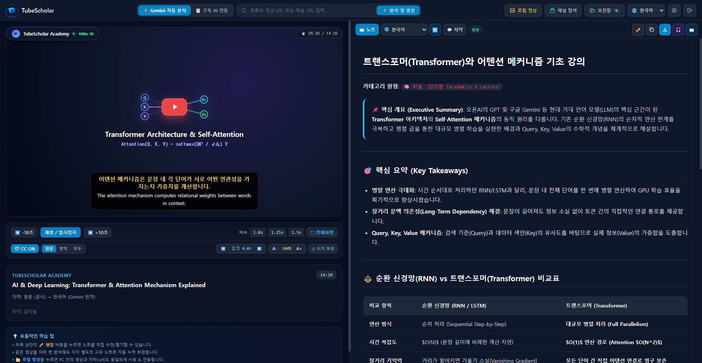
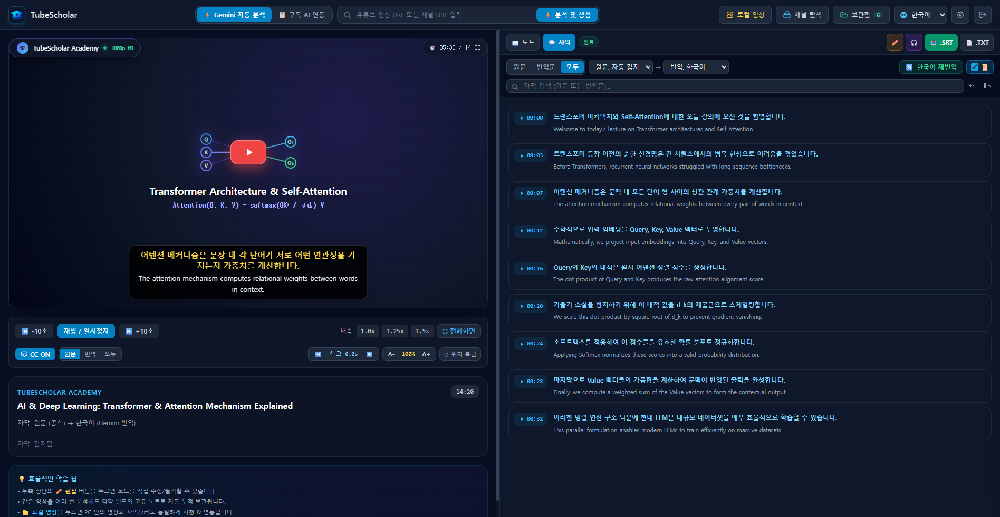
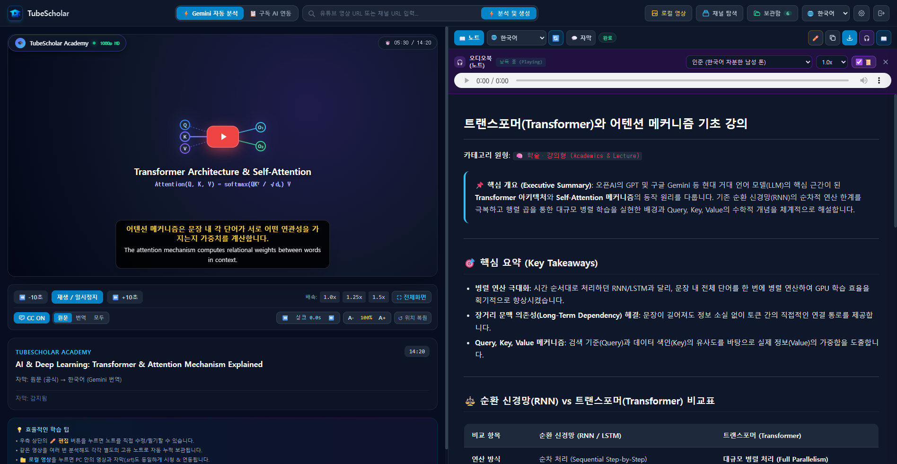
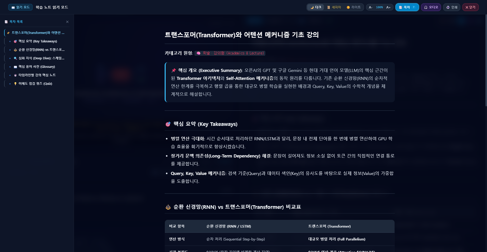
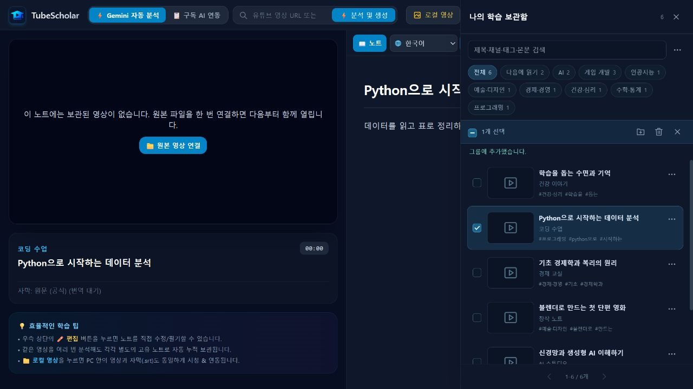

# 🎓 TubeScholar - 유튜브 & 로컬 비디오 LLM 심층 지식 확장 학습기

**한국어** | [🇺🇸 English](README_EN.md)

**TubeScholar**는 유튜브 영상과 내 PC의 로컬 비디오(`.mp4`, `.webm`, `.mkv`)를 나만의 완벽한 지식 교재로 바꾸어 주는 **인터랙티브 데스크톱 AI 학습 플랫폼**입니다.

단순한 자막 번역이나 단편적인 요약을 뛰어넘어, **[자막 오류 교정 + 타임라인 핵심 요약 + 심화 배경지식(Deep Dive) + 전문용어 사전 + 실시간 인라인 자막 편집 + 듀얼 신경망 오디오북(노트 낭독 & 자막 전체 성우 더빙)]**까지 올인원으로 제공합니다.

무료 Google Gemini API는 물론, 이미 구독 중인 ChatGPT Plus / Claude Pro 등의 외부 LLM과도 유연하게 연동되며, 모든 학습 결과는 내 PC에 표준 마크다운(`.md`)으로 영구 보관되어 노션(Notion) 및 옵시디언(Obsidian)과 완벽하게 호환됩니다.

<p align="center">
  
</p>

---

## 🌟 주요 핵심 기능

### 1. ⏱️ 타임스탬프 연동 인터랙티브 스플릿 뷰 (Split-View) & 원클릭 로컬 분석
- **좌측**: YouTube 플레이어 및 내 PC의 로컬 영상(`.mp4`, `.webm`, `.mkv`)과 자막(`.srt`, `.vtt`) 완벽 시청 지원.
- **통합 로컬 영상 분석**: 첨부 자막이 있으면 즉시 분석하고, 자막이 없으면 Groq Whisper 전사 또는 Gemini 음성 직접 분석으로 자동 연결합니다.
- **우측**: 마크다운 학습 노트 (타임스탬프 `[03:25]` 클릭 시 해당 영상 위치로 즉시 점프).
- **실시간 드래그 자막 오버레이**: 마우스로 원하는 위치에 배치 가능한 CC 자막, 글자 크기 조절, `[` / `]` 단축키 싱크 미세 보정.

### 2. 🧠 단순 번역을 초월한 LLM 심층 지식 확장 (Deep Dive)
- **자막 오류 교정**: 자동 생성 자막의 고유명사, 전문용어, 음성 인식 오인식 교정.
- **지식 보충 해설 (Deep Dive)**: 영상에서 스쳐 지나가는 원리, 수식, 배경 맥락을 친절한 보충 설명 박스로 상세 해설.
- **핵심 어휘 사전 (Glossary)**: 영상에 사용된 주요 전문 표현 및 맥락 해설 표 제공.
- **이해도 점검 퀴즈**: 핵심 질문 및 셀프 체크.
- **17개 다국어 노트 생성 지원**: 한국어, 영어, 일본어 등 원하는 언어로 학습 노트를 즉시 생성 및 재작성(`🔄`).

### 3. 💬 인터랙티브 자막 스튜디오 & 실시간 직접 편집
- **3대 뷰 모드 & 다국어 번역 캐시 보존**: `원문`, `번역문(Trans)`, `모두(Both)` 3가지 모드로 대사를 시청하며, 번역된 다국어 자막 데이터를 노트별로 자동 보존·복원합니다.
- **자막 직접 수정 모드 (In-Place Editor)**: 오타나 어색한 번역 대사를 UI에서 바로 타이핑 수정(`✏️`) 및 즉각 저장(`Ctrl+Enter`). 원본 타임스탬프를 100% 안전하게 보존.
- **실시간 싱크 자동 스크롤**: 영상 재생 위치에 맞춰 현재 자막이 자동으로 스크롤 및 하이라이트 (컴팩트 `📜` 체크박스 토글).
- **실시간 검색 및 무중단 내보내기**: 자막 키워드 검색, `.SRT` 및 `.TXT` 파일 즉시 다운로드(클라이언트 메모리 폴백 지원으로 저장 전·후 언제든 내보내기 가능).

<p align="center">
  
</p>

### 4. 🎧 듀얼 AI 신경망 오디오북 & 영구 동기화 시스템 (edge-tts)
- **7개 국어 · 16종 고품질 신경망 성우 & 언어별 자동 매칭**: 한국어, 영어, 일본어, 중국어, 스페인어, 프랑스어, 독일어 등 7개 언어 총 16종의 Microsoft Neural 음성을 지원하며, 노트·자막의 실제 언어에 맞춰 호환되는 성우를 스마트하게 자동 전환합니다.
- **학습 노트 오디오북**: 마크다운 학습 노트를 문단별 하이라이트와 함께 고품질 신경망 음성으로 낭독하는 오디오북 플레이어.
- **자막 더빙 오디오북 (Subtitle Dubbing)**: 영상의 자막 대사 전체를 성우 음성으로 더빙하여 들려주며, 대사별 실시간 하이라이트 및 자동 스크롤 추적을 지원합니다.
- **노트-오디오북 영구 결합 & 구버전 자동 정리**: 노트를 저장할 때 생성된 오디오북(`.mp3`)과 타임라인 큐(`.json`)가 함께 영구 바인딩되어 보관함에서 다시 열면 **재생성 없이 즉시 오디오북 재생 및 하이라이트 싱크가 100% 복원**되며, 노트나 자막 수정 시 이전 해시의 구버전 오디오 캐시를 자동으로 정리합니다.
- **0ms 즉각 세션 전환 & 직관적인 파일명 다운로드**: 학습 노트 오디오북(`{영상제목}_오디오북.mp3`)과 자막 더빙 오디오북(`sub_{영상제목}_오디오북.mp3`) 모두 직관적인 영상 제목 기반 파일명으로 다운로드됩니다.

<p align="center">
  
</p>

### 5. 📖 집중 독서 모드 (Zen Reader View)
- 영상과 패널을 접고 책처럼 편안하게 읽는 집중 독서 모드 (단축키: `Z`).
- 다크 / 세피아(종이책) / 라이트 테마 지원, 글자 크기 조절, 자동 목차(TOC) 패널 제공.

<p align="center">
  
</p>

### 6. 📋 구독형 AI(ChatGPT / Claude) 연동, 수식 표준화 및 출처 태그 자동 정제
- 이미 사용 중인 ChatGPT Plus, Claude Pro 등에서 분석한 답변을 인라인으로 붙여넣어 TubeScholar 전용 학습 노트로 즉시 적용 및 영구 저장.
- 클립보드 프롬프트 자동 생성 시 복잡한 LaTeX 대신 표준 마크다운(코드 블록, 인용구)으로 수식을 작성하도록 유도.
- AI 답변에 섞여 들어오는 `:chatgpt-content-reference{...}`, `【4:0†source】`, `[cite: 1]` 등의 출처 참조 찌꺼기 및 깨진 원시 LaTeX 수식 코드(`\[...\]`, `_{...}`)를 미려한 표준 마크다운 공식 박스(`> 📐 **공식**: ...`)로 자동 필터링 및 정제.

### 7. 🌐 직관적인 UI 및 초고속 분리형 영구 보관소
- **한국어 / 영어 2개 공식 UI** 언어 지원 (헤더 드롭다운으로 즉시 전환).
- **분리형 고속 스토리지 아키텍처**: 마크다운 노트(`data/notes/`), 대용량 다국어 자막 번들(`data/subtitles/`), 신경망 오디오북 및 타임라인 큐(`data/audio/`), 로컬 영상 사본(`data/videos/`, SHA-256 중복 제거)을 독립 분리하고 `mtime` 기반 인메모리 캐싱을 적용하여 수백 개의 노트가 쌓여도 보관함을 즉각 로딩합니다.
- **로컬 영상·자막·노트 통합 복원**: 분석한 로컬 영상은 앱 데이터에 안전하게 보관되어, 원본 파일 위치가 바뀌거나 앱을 재시작해도 보관함에서 영상·자막·노트가 함께 열립니다 (노트 생성 실패 시에도 보관된 자막으로 재업로드 없이 즉각 재작성 가능).
- **보관함 오디오북 배지 (`🎧`) & 자동 리셋**: 보관함 드로어(Drawer)에서 오디오북이 함께 저장된 노트를 `🎧` 배지로 한눈에 식별하며, 다른 노트로 전환 시 이전 오디오 세션을 깔끔하게 초기화하고 해당 노트의 오디오북을 즉시 동기화합니다.
- 생성된 모든 학습 문서는 표준 `.md` 파일로 영구 보관되어 **Obsidian**, **Logseq**, **Notion** 등에 즉시 복사/연동 가능.

<p align="center">
  
</p>

### 8. 📝 마크다운 템플릿 독립 분리 & 사용자 커스터마이징 (Prompt & Markdown Templates)
- **코드 무수정 양식 변경**: 실행 코드 내부에 있던 긴 마크다운 양식을 독립 파일(`prompts/system_*.md`)로 완전히 분리하여, 마크다운 파일만 수정하면 다음 분석 시 즉각 새로운 형식의 학습 노트가 생성됩니다.
- **다국어 맞춤 템플릿 & 로컬 자막 언어 자동 감지**: 유튜브뿐만 아니라 로컬 영상·자막(`.srt`, `.vtt`)의 원문 언어도 자동 감지하여 한국어 번역용(`system_ko.md`), 국내 한국어 원본용(`system_ko_native.md`), 영어(`system_en.md`), 일본어(`system_ja.md`), 다국어 범용(`system_default.md`) 템플릿을 정확하게 분기 적용합니다.
- **사용자 오버레이 시스템**: 사용자 데이터 폴더(`data/prompts/`)에 본인만의 `.md` 양식을 넣으면 최우선 적용(Overlay)되며, 삭제 시 언제든 기본 양식으로 안전하게 복원됩니다.

---

## 🚀 빠른 시작 방법

### A. Windows 설치 프로그램 사용 (일반 사용자 추천)
[Latest Release](https://github.com/makopss/TubeScholar/releases)에서 `TubeScholar-Setup-v1.2.3.exe`를 다운로드하여 실행하시면 Python 설치 없이 바로 사용할 수 있습니다.

### B. 소스코드 직접 실행 (개발자용)
1. **저장소 클론**:
   ```bash
   git clone https://github.com/makopss/TubeScholar.git
   cd TubeScholar
   ```

2. **가상환경 생성 및 의존성 설치**:
   ```bash
   python -m venv .venv
   .venv\Scripts\activate      # Windows
   # source .venv/bin/activate # macOS/Linux
   pip install -r requirements.txt
   ```

3. **프론트엔드 스타일 빌드 (수정 시 필요)**:
   ```bash
   npm install
   npm run build:css
   ```

4. **실행**:
   ```bash
   python run.py
   ```
   실행하면 기본 웹 브라우저에서 `http://127.0.0.1:8000`이 자동으로 열립니다.

---

## ⚙️ API 키 설정

웹 화면 우측 상단의 ⚙️ **설정** 아이콘을 클릭하여 등록합니다 (로컬 `.env`에 안전하게 보관됩니다):

1. **Google Gemini 무료 API 키**: [Google AI Studio](https://aistudio.google.com/app/apikey)에서 무료로 발급받아 입력합니다.
   - **스마트 자동 모델 엔진**: 노트 생성은 기본 `gemini-3.5-flash`, 자막 번역은 `gemini-flash-lite-latest`를 사용하며, 서버 혼잡·할당량 초과 시 제한 시간 안에서 대체 모델로 자동 다단계 페일오버(Fallback)됩니다.
2. **Groq Cloud 무료 API 키 (선택 사항)**: [Groq Console](https://console.groq.com/keys)에서 무료로 발급받아 등록합니다.
   - 자막이 없는 로컬 영상이나 음성 파일 학습 시, 오픈소스 최강 Whisper-large-v3 초고속 AI 음성인식 엔진으로 실시간 자막을 추출하거나 번역할 때 활용됩니다.
3. **💡 구독형 AI 사용자 (API 키 없이 무료 사용)**:
   - ChatGPT Plus나 Claude Pro 등을 이미 구독 중이시라면 **별도의 API 키 입력 없이도 100% 무료**로 사용할 수 있습니다.
   - 상단의 [📋 클립보드 프롬프트 복사]로 프롬프트를 복사하여 대화창에 넣고, 생성된 답변을 TubeScholar에 붙여넣기만 하면 전용 마크다운 노트 저장, 수식/출처 자동 정제, 타임스탬프 싱크, 듀얼 오디오북 청취까지 모든 기능을 완벽하게 누릴 수 있습니다.

---

## 📁 디렉토리 구조

```
TubeScholar/
├── backend/
│   ├── app.py              # FastAPI 메인 서버 & API 라우터
│   ├── config.py           # 공통 환경 설정 및 경로 상수 모듈
│   ├── analysis_jobs.py    # 작업별 취소·진행 상태·전체 제한 시간·업로드 검사
│   ├── media_process.py    # 취소 가능한 FFmpeg 실행 및 오류 기록
│   ├── prompt_loader.py    # 동적 마크다운 템플릿 로더 및 사용자 커스텀 오버레이
│   ├── extractor.py        # 유튜브 자막 및 메타데이터 추출기
│   ├── analyzer.py         # Google Gemini 지식 확장 & 스마트 모델 엔진
│   ├── storage.py          # 마크다운 노트 & 분리형 자막 번들 & 오디오북·영상 저장소
│   ├── tts.py              # edge-tts 신경망 오디오북 & 자막 더빙 엔진
│   ├── stt.py              # Groq Cloud Whisper-large-v3 초고속 음성인식
│   └── languages.py        # 17개 다국어 지원 언어 카탈로그
├── prompts/                # 언어별 독립 마크다운 시스템 프롬프트 템플릿
│   ├── system_ko.md        # 한국어 (해외 영상 번역/분석용)
│   ├── system_ko_native.md # 한국어 (국내 영상 구어체 정돈/심화용)
│   ├── system_en.md        # 영어 마스터 지식 노트
│   ├── system_ja.md        # 일본어 마스터 지식 노트
│   ├── system_default.md   # 기타 다국어용 범용 템플릿
│   └── README.md           # 프롬프트 커스터마이징 가이드
├── frontend/
│   ├── index.html          # 스플릿 뷰 대시보드 UI
│   ├── app.js              # 통합 인터랙티브 클라이언트 JS (플레이어, 자막 편집기, 오디오북)
│   ├── i18n.js             # 다국어(한국어, 영어) UI 카탈로그
│   ├── style.css           # 전용 다크 테마 & 커스텀 UI 스타일
│   └── vendor/             # 독립 오프라인 라이브러리 (Tailwind, Marked, DOMPurify)
├── data/
│   ├── notes/              # 영구 보관 마크다운(.md) 학습 노트
│   ├── subtitles/          # 노트별 분리 보관 자막·번역 번들 (.json)
│   ├── audio/              # 영구 보관 신경망 오디오북 (.mp3) 및 타임라인 큐 (.json)
│   ├── videos/             # 로컬 영상 사본 영구 보관소 (SHA-256 중복 제거)
│   ├── prompts/            # 사용자 맞춤 커스텀 마크다운 템플릿 (선택 사항)
│   └── library.json        # 영상 메타데이터 및 학습 기록 색인
├── run.py                  # 원클릭 서버 실행 및 브라우저 자동 실행
├── requirements.txt        # Python 백엔드 의존성 목록
├── build_installer.bat     # Windows 원클릭 설치 프로그램 빌드 스크립트
├── installer.iss           # Inno Setup 6 설치 마법사 정의 파일
└── TubeScholar.spec        # PyInstaller 데스크톱 앱 번들링 명세서
```

---

## 🛠️ 기술 스택 (Tech Stack)

- **Backend**: FastAPI, Python 3.10+, Uvicorn, Google GenAI SDK (`google-genai`), Groq SDK (`groq`), `imageio-ffmpeg`, `yt-dlp`, `youtube-transcript-api`, `edge-tts` (`7.3.1+`)
- **Frontend**: Vanilla JavaScript (ES6+), Web Worker Heartbeat, Tailwind CSS (Standalone build), Marked.js, DOMPurify
- **Security & Stability**: Localhost Origin/Host 검증 미들웨어, `os.replace` 원자적 파일 쓰기(Atomic Write), `threading.RLock` 동시성 보호
- **Packaging**: PyInstaller (`onedir` 모드), Inno Setup 6 (`lzma2/ultra64` Windows 설치 마법사)

---

## ⚠️ 면책 조항 (Disclaimer)

1. **상표 및 제3자 제휴 (Trademarks & Affiliation)**:
   - TubeScholar는 독립적인 오픈소스 프로젝트이며, YouTube, Google LLC, Alphabet Inc., Microsoft, Groq 등과 어떠한 공식 제휴, 보증 또는 후원 관계도 없습니다.
   - 'YouTube' 및 관련 상표, 로고는 Google LLC의 등록 상표입니다.
2. **저작권 및 공정 이용 (Copyright & Fair Use)**:
   - 본 소프트웨어는 **개인의 비영리적 학습, 연구 및 교육적 목적(Fair Use)**으로만 제공됩니다.
   - 사용자는 거주 국가의 저작권법 및 대상 플랫폼(YouTube 등)의 서비스 이용약관을 준수할 전적인 책임이 있으며, DRM 우회 또는 저작권 침해 용도로 사용하는 것을 엄격히 금지합니다.
3. **AI 생성 결과물의 정확성 및 환각 (AI Accuracy & Hallucination)**:
   - 본 프로그램에서 생성되는 학습 노트, 번역문 및 요약은 대규모 언어 모델(Google Gemini 등)에 의해 자동 생성되므로, 사실과 다른 내용(환각 현상)이나 불완전한 정보가 포함될 수 있습니다.
   - 개발자는 생성된 결과물의 정확성, 신뢰성, 완전성 또는 특정 목적에 대한 적합성을 보증하지 않으며, 이를 바탕으로 한 학업·연구·의사결정의 결과에 대해 책임을 지지 않습니다.
4. **외부 API 사용 및 비용 (API Usage & Billing)**:
   - 본 프로그램은 사용자가 직접 발급받은 API 키를 로컬 기기에 보관하며 동작합니다. API 제공사의 이용 약관, 정책 변경, 할당량 초과 및 발생할 수 있는 유료 과금에 대한 모든 관리 책임은 사용자 본인에게 있습니다.
5. **무보증 및 책임의 한계 (No Warranty & Limitation of Liability)**:
   - 본 소프트웨어는 "있는 그대로(AS IS)" 제공되며, 상업성 및 특정 목적에의 적합성 보증을 포함한 일체의 명시적·묵시적 보증을 배제합니다. 본 소프트웨어의 사용 또는 사용 불능으로 인해 발생하는 일체의 직접적, 간접적 손해에 대해 개발자는 법적 책임을 지지 않습니다.

---

## 📄 라이선스 (License)

이 프로젝트는 [MIT License](LICENSE)에 따라 배포됩니다. 자세한 내용은 [LICENSE](LICENSE) 파일을 참조하십시오.
오픈소스 커뮤니티의 기여와 PR을 진심으로 환영합니다!

