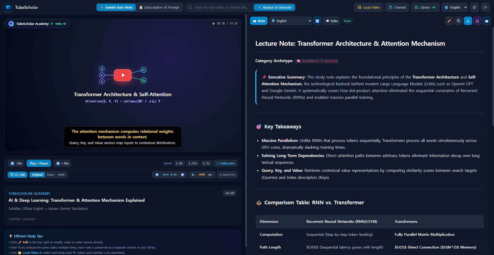

# 🎓 TubeScholar - YouTube & Local Video LLM Deep Study Studio

[🇰🇷 한국어 설명서](README.md) | **English**

**TubeScholar** is an all-in-one desktop AI study companion that turns YouTube videos and local video files (`.mp4`, `.webm`, `.mkv`) into structured, permanent learning materials.

Going far beyond simple subtitle translation and generic summaries, it delivers **[Subtitle Error Correction + Timestamped Timeline Summaries + Deep Dive Conceptual Callouts + Technical Glossaries + In-Place Subtitle Editing + Dual Neural Audiobooks (Note Narration & Full Voice Dubbing)]**.

Works seamlessly with free Google Gemini API or your existing ChatGPT Plus / Claude Pro subscriptions, with all study notes saved locally on your machine in standard Markdown (`.md`)—100% compatible with Notion, Obsidian, and Logseq.

## 🆕 v1.2.2 — Reliable local video analysis

- **Cancellation and switching**: Each analysis owns its cancellation and progress state; late results cannot overwrite a newer analysis.
- **Bounded processing**: Audio extraction, transcription and Gemini requests support cancellation and time limits. The default total deadline is 10 minutes, including upload.
- **Recoverable transcripts**: Completed Groq transcripts and imported subtitle files are saved before note generation. After a failure or cancellation, reopen the saved entry and choose **Regenerate note (🔄)** without uploading or transcribing the video again.
- **Subtitle integrity**: Missing or invalid generated SRT is reported as unavailable. Note summaries are never substituted for spoken dialogue.
- **Upload and packaging checks**: Upload limits are enforced while receiving data, and builds check native-wheel compatibility with the Python interpreter.

[Release and installer](https://github.com/makopss/TubeScholar/releases/tag/v1.2.2) · [Analysis and verification guide](docs/local-analysis.md)

<p align="center">
  
</p>

---

## 🌟 Key Features

### 1. ⏱️ Interactive Timestamped Split-View
- **Left Panel**: Integrated video player supporting both YouTube streams and offline local video files (`.mp4`, `.webm`, `.mkv`) with `.srt` subtitle tracks.
- **Right Panel**: Structured Markdown study note. Clicking any timestamp (e.g. `[03:25]`) instantly jumps playback to that exact moment.
- **Draggable CC Subtitle Overlay**: Real-time subtitles rendered directly over the video with custom font sizing, sync adjustment (`[` and `]`), and full-screen view.

### 2. 🧠 LLM Deep Knowledge Expansion (Deep Dive)
- **Contextual Correction**: Auto-corrects terminology, proper nouns, and speech-to-text misrecognitions in video transcripts.
- **Deep Dive Callouts**: Explains background theories, equations, architecture patterns, and prerequisites referenced in passing.
- **Technical Glossary**: Comprehensive table of key terms and context-specific meanings.
- **Comprehension Check**: Interactive self-study quiz questions reinforcing core concepts.
- **Multi-language Generation**: Generates study notes in 17 world languages.

### 3. 💬 Interactive Subtitle Studio & Direct Editing
- **3 Reading Modes & Multilingual Cache Preservation**: Switch seamlessly between `Original`, `Trans` (translated), and `Both` (bilingual display) while automatically preserving and restoring translated subtitle tracks per saved note.
- **In-Place Subtitle Editor**: Directly edit and correct subtitle typos/mistranslations in the browser (`✏️`) with instant saving (`Ctrl+Enter`) while preserving exact video timestamps.
- **Synchronized Auto-Scroll**: Highlights and scrolls automatically to the currently playing subtitle line (with a compact `📜` toggle).
- **Instant Search & Resilient Export**: Full-text keyword search across lines; one-click export to `.SRT` and `.TXT` with automatic client-side memory fallback so exports work before and after saving.

<p align="center">
  
</p>

### 4. 🎧 Dual AI Neural Audiobook & Persistent Sync System (edge-tts)
- **7 Languages, 16 Microsoft Neural Voices & Smart Voice Matching**: Choose from 16 expressive neural voices across Korean, English, Japanese, Chinese, Spanish, French, and German, with automatic language-compatible voice selection when switching between notes and subtitle tracks.
- **Study Note Audiobook**: Listen to generated markdown study notes with paragraph-by-paragraph highlight synchronization.
- **Subtitle Dubbing Audiobook (Subtitle Dubbing)**: Voices entire subtitle transcripts in natural spoken tone, synchronized with real-time text highlight cues and auto-scroll.
- **Persistent Note-Audiobook Binding & Stale Cache Cleanup**: Generated audiobooks (`.mp3`) and timeline cue maps (`.json`) are permanently bound to your saved study notes—instantly restoring the player and 100% cue highlight sync on reload—while automatically cleaning up outdated audio files when notes or subtitles are edited.
- **Zero-Latency Session Switching & Clean Download Filenames**: Toggle seamlessly between Note Audiobook (`{Title}_Audiobook.mp3`) and Subtitle Dubbing (`sub_{Title}_Audiobook.mp3`) with configurable narration speed (`0.75x` – `2.0x`) and clean title-based `.mp3` downloads.

<p align="center">
  
</p>

### 5. 📖 Zen Reader View
- Distraction-free full reading view with Dark, Sepia, and Light paper themes, adjustable typography, and an automatic floating Table of Contents (TOC).

<p align="center">
  
</p>

### 6. 📋 Subscription AI (ChatGPT / Claude) Integration, Formula Standardization & Artifact Cleaner
- Easily paste markdown notes generated by your own ChatGPT Plus or Claude subscriptions into TubeScholar for persistent storage and player integration.
- Clipboard prompts enforce plain Markdown formulas rather than unrendered LaTeX math markup.
- Automatically cleans search citations and reference tags (e.g. `:chatgpt-content-reference{...}`, `【...】`, `[cite: ...]`) and transforms raw LaTeX math blocks (`\[...\]`, `_{...}`) into clean, universal formula quote boxes (`> 📐 **공식**: ...`).

### 7. 🌐 Clean Bilingual UI & High-Speed Decoupled Storage
- Streamlined modern interface available in **Korean** and **English** (instant header dropdown switch).
- **Decoupled High-Speed Storage Architecture**: Separates Markdown notes (`data/notes/`), heavy multilingual subtitle bundles (`data/subtitles/`), and neural audiobooks/cues (`data/audio/`) with `mtime`-based in-memory index caching—keeping library loading instantaneous even with hundreds of saved notes.
- **Library Audiobook Badge (`🎧`) & Auto-Reset**: Easily spot notes with saved audiobooks via the `🎧` badge in the Library drawer. Switching notes cleanly resets any active audio playback and immediately synchronizes the newly selected note's saved audiobook.
- All study notes are stored permanently in standard Markdown, ready to be synced with **Obsidian**, **Logseq**, or **Notion**.

<p align="center">
  
</p>

### 8. 📝 Decoupled Markdown Templates & User Customization (Prompt & Markdown Templates)
- **Zero-Code Format Customization**: System prompts and note templates have been decoupled from source code into independent markdown files (`prompts/system_*.md`). Modify any markdown file and your custom format applies immediately to subsequent video analyses.
- **Dedicated Multilingual Templates & Local Subtitle Auto-Detection**: Automatically detects source languages for both YouTube and local `.srt`/`.vtt`/video files, routing appropriately to foreign-to-Korean translation (`system_ko.md`), native Korean enhancement (`system_ko_native.md`), English (`system_en.md`), Japanese (`system_ja.md`), or general multilingual (`system_default.md`) templates.
- **User Overlay System**: Place customized `.md` files in your user data directory (`data/prompts/`) to prioritize personal note formats over default built-ins, with instantaneous fallback upon removal.

---

## 🚀 Quick Start

### Installation & Launch

#### Option A: Windows Installer (Recommended for non-developers)
Download and run [TubeScholar-Setup-v1.2.2.exe](https://github.com/makopss/TubeScholar/releases/download/v1.2.2/TubeScholar-Setup-v1.2.2.exe). No Python installation is required. A SHA-256 checksum file is included with the release.

#### Option B: Run from Source
1. **Clone the repository:**
   ```bash
   git clone https://github.com/makopss/TubeScholar.git
   cd TubeScholar
   ```

2. **Set up Python Virtual Environment:**
   ```bash
   python -m venv .venv
   .venv\Scripts\activate      # Windows
   # source .venv/bin/activate # macOS/Linux
   pip install -r requirements.txt
   ```

3. **Compile Frontend Styles (Optional if modified):**
   ```bash
   npm install
   npm run build:css
   ```

4. **Launch TubeScholar:**
   ```bash
   python run.py
   ```
   The browser will automatically open to `http://127.0.0.1:8000`.

---

## 🔧 Analysis settings, builds and verification

- The default upload limit is **2GB** and the total analysis deadline is **600 seconds**.
- Configure `TUBESCHOLAR_MAX_VIDEO_MB` and `TUBESCHOLAR_ANALYSIS_TIMEOUT_SECONDS` in `%LOCALAPPDATA%\TubeScholar\.env` for the installed app, or the project `.env` when running from source.
- Logs include job IDs, UTC timestamps, stages, models and elapsed time. Installed-app logs are stored at `%LOCALAPPDATA%\TubeScholar\tubescholar.log`.
- Create the build environment with its own Python interpreter and install dependencies there. Copying `site-packages` from another Python version can cause DLL import failures.

```powershell
# Offline regression tests (28 backend + 6 frontend tests)
.\.venv\Scripts\python.exe -u -B scripts\test_analysis.py
node --test scripts\test_analysis_frontend.cjs

# Build the Windows installer (requires Inno Setup 6)
.\build_installer.bat

# Verify packaged startup and transcript persistence (PowerShell 7; port 8000 must be free)
.\scripts\smoke_packaged.ps1
```

---

## ⚙️ Configuration

Click the ⚙️ **Settings** icon in the top header (saved locally and securely in `.env`):

1. **Google Gemini Free API Key**: Get a free API key from [Google AI Studio](https://aistudio.google.com/app/apikey) and enter it.
   - **Automatic model fallback**: Study notes default to `gemini-3.5-flash`; subtitle translation uses `gemini-flash-lite-latest`. When a server is overloaded or slow, alternative models are tried within the analysis deadline.
2. **Groq Cloud Free API Key (Optional)**: Get a free key from [Groq Console](https://console.groq.com/keys).
   - Used for ultra-fast local video/audio speech recognition (Whisper-large-v3) when analyzing local files without existing subtitle tracks.
3. **💡 Subscription AI Users (Free without API Keys)**:
   - If you already subscribe to ChatGPT Plus or Claude Pro, you can use TubeScholar **100% free with no API keys required**.
   - Simply click [📋 Copy Prompt], paste into your ChatGPT/Claude chat, and paste the response back into TubeScholar to enjoy persistent markdown notes, automatic formula & citation cleaning, timestamp jumps, and dual audiobooks!

---

## 📁 Directory Structure

```
TubeScholar/
├── backend/
│   ├── app.py              # FastAPI server & API routing
│   ├── config.py           # Unified environment & path configuration module
│   ├── analysis_jobs.py    # Per-job cancellation, progress, deadlines & upload limits
│   ├── media_process.py    # Cancellable FFmpeg execution & diagnostics
│   ├── prompt_loader.py    # Dynamic markdown template loader & user overlay manager
│   ├── extractor.py        # YouTube subtitle & metadata extractor
│   ├── analyzer.py         # Google Gemini knowledge expansion & smart fallback engine
│   ├── storage.py          # Markdown notes, decoupled subtitle bundles & audiobook store
│   ├── tts.py              # edge-tts neural audiobook & subtitle dubbing engine
│   ├── stt.py              # Groq Cloud Whisper-large-v3 ultrafast STT engine
│   └── languages.py        # 17-language catalog & normalization
├── prompts/                # Decoupled markdown system prompt templates
│   ├── system_ko.md        # Korean (foreign video translation/analysis)
│   ├── system_ko_native.md # Korean (native content enhancement)
│   ├── system_en.md        # English master knowledge note
│   ├── system_ja.md        # Japanese master knowledge note
│   ├── system_default.md   # General multilingual template
│   └── README.md           # Prompt customization guide
├── frontend/
│   ├── index.html          # Interactive split-view dashboard UI
│   ├── app.js              # Unified interactive client JS (Player, Subtitle Editor, Audiobooks)
│   ├── i18n.js             # Multilingual (English, Korean) UI catalog
│   ├── style.css           # Custom dark theme & reader styling
│   └── vendor/             # Standalone offline vendor libraries (Tailwind, Marked, DOMPurify)
├── data/
│   ├── notes/              # Permanent Markdown (.md) study notes
│   ├── subtitles/          # Decoupled per-note subtitle & translation bundles (.json)
│   ├── audio/              # Persistent neural audiobooks (.mp3) & timeline cues (.json)
│   ├── prompts/            # User custom markdown templates (Optional)
│   └── library.json        # Video metadata & study session index
├── scripts/                # Regression tests, build checks & packaged smoke test
├── docs/local-analysis.md  # Recovery, deadlines & verification guide
├── run.py                  # One-click server launcher & browser watchdog
├── requirements.txt        # Python backend dependency manifest
├── build_installer.bat     # Windows one-click installer build script
├── installer.iss           # Inno Setup 6 installer specification
└── TubeScholar.spec        # PyInstaller desktop bundling spec
```

---

## 🛠️ Tech Stack

- **Backend**: FastAPI, Python 3.10+, Uvicorn, Google GenAI SDK (`google-genai`), Groq SDK (`groq`), `imageio-ffmpeg`, `yt-dlp`, `youtube-transcript-api`, `edge-tts` (`7.3.1+`)
- **Frontend**: Vanilla JavaScript (ES6+), Web Worker Heartbeat, Tailwind CSS (Standalone build), Marked.js, DOMPurify
- **Security & Stability**: Localhost Origin/Host validation middleware, atomic file writes (`os.replace`), `threading.RLock` concurrency protection
- **Packaging**: PyInstaller (`onedir` mode), Inno Setup 6 (`lzma2/ultra64` Windows Setup Wizard)

---

## ⚠️ Disclaimer

1. **Trademarks & Affiliation**:
   - TubeScholar is an independent open-source project and is not affiliated with, endorsed by, or sponsored by YouTube, Google LLC, Alphabet Inc., Microsoft, or Groq.
   - 'YouTube' and the YouTube logo are registered trademarks of Google LLC.
2. **Copyright & Fair Use**:
   - This software is strictly intended for **personal, non-commercial educational and research purposes (Fair Use)**.
   - Users are solely responsible for ensuring compliance with applicable copyright laws and the terms of service of any third-party platform (including YouTube). Bypassing DRM or facilitating copyright infringement is strictly prohibited.
3. **AI Accuracy & Hallucination**:
   - Study notes, translations, and summaries are generated automatically by Large Language Models (such as Google Gemini). AI outputs may contain factual inaccuracies, omissions, or hallucinations.
   - The authors do not guarantee the correctness, completeness, or fitness for any particular purpose of the generated content.
4. **API Usage & Costs**:
   - TubeScholar operates using API keys provided by the user and stored locally on the user's machine. Users are solely responsible for managing their own quotas, terms, and potential billing charges incurred with external API providers.
5. **No Warranty & Limitation of Liability**:
   - The software is provided "AS IS", without warranty of any kind, express or implied, including but not limited to the warranties of merchantability, fitness for a particular purpose, and non-infringement. In no event shall the authors be liable for any claim, damages, or other liability arising from the use of this software.

---

## 📄 License

This project is licensed under the [MIT License](LICENSE). See the [LICENSE](LICENSE) file for full details.
Contributions and pull requests from the open-source community are warmly welcome!

